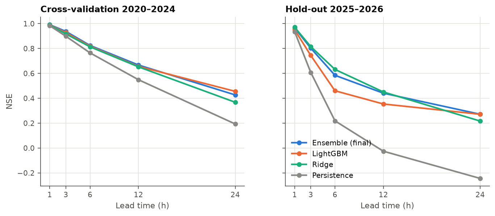
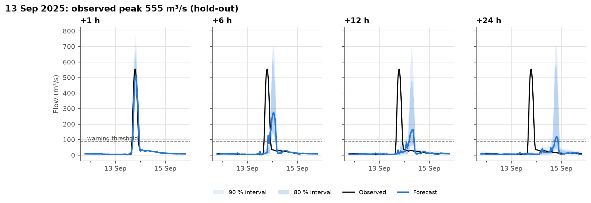
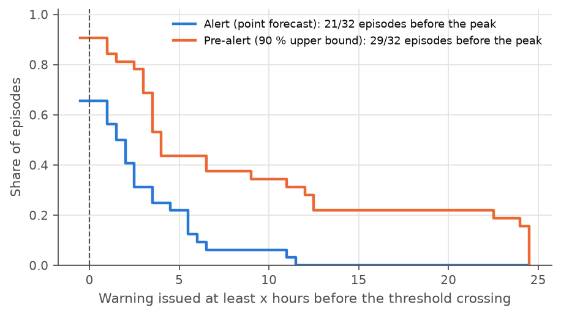
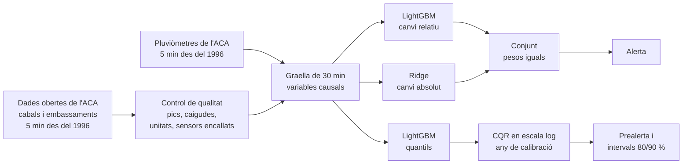

# Predicció de crescudes del Llobregat

[](https://github.com/joangordo/llobregat-prediccio-crescudes/actions/workflows/ci.yml)


Predicció probabilística del cabal del Llobregat a Sant Joan Despí (4.908 km²) d'1 a 24 hores
vista, cada 30 minuts, amb intervals de predicció calibrats i un avís de dos nivells.

Aquest projecte és l'ampliació del meu Treball de Fi de Grau d'Estadística (Universitat de
Barcelona, 2026). Les diferències i millores respecte al TFG s'expliquen a
[docs/millores-respecte-al-tfg.md](docs/millores-respecte-al-tfg.md).

> **No és un sistema oficial d'avís.** És un projecte de recerca. La informació oficial la
> donen l'[Agència Catalana de l'Aigua](https://aca.gencat.cat) i
> [Protecció Civil de Catalunya](https://interior.gencat.cat/ca/arees_dactuacio/proteccio_civil/).

**Predicció en temps real:** [joangordo.github.io/llobregat-flood-forecast-live](https://joangordo.github.io/llobregat-flood-forecast-live/)
(codi: [llobregat-flood-forecast-live](https://github.com/joangordo/llobregat-flood-forecast-live))
(GitHub Actions + GitHub Pages, cada 30 minuts).

El codi, els comentaris i els noms de les sortides són en anglès, igual que a la
[versió en anglès](https://github.com/joangordo/llobregat-flood-forecasting) d'aquest
repositori; la documentació d'aquesta versió és en català.



## Resultats principals

El sistema es va tancar amb la validació creuada (anys de test 2020–2024) i després es va
avaluar una sola vegada amb dos anys reservats (anys hidrològics 2025 i 2026, d'octubre del
2024 a setembre del 2026):

| NSE | +1 h | +3 h | +6 h | +12 h | +24 h |
|---|---|---|---|---|---|
| Validació creuada 2020–2024, conjunt | 0,992 | 0,938 | 0,825 | 0,667 | 0,427 |
| Validació creuada 2020–2024, persistència | 0,983 | 0,899 | 0,765 | 0,549 | 0,193 |
| **Anys reservats 2025–2026, conjunt** | **0,966** | **0,803** | **0,585** | **0,441** | **0,272** |
| Anys reservats 2025–2026, persistència | 0,936 | 0,608 | 0,219 | −0,026 | −0,244 |

Al període de test del TFG (juny 2025 – maig 2026), que és dins dels anys reservats:

| NSE | +1 h | +3 h | +6 h |
|---|---|---|---|
| Model del TFG (M7) | 0,85 | — | 0,62 |
| Persistència | 0,945 | 0,659 | 0,333 |
| **Aquest projecte** | **0,978** | **0,852** | **0,666** |

- **Supera la persistència a tots els horitzons**, a la validació creuada (amb intervals de
  confiança bootstrap per blocs mensuals que no inclouen el zero) i als anys reservats. El
  model del TFG no la superava fins a +3 h.
- **Avís anticipat** (llindar: 87 m³/s, el percentil 99 dels cabals d'entrenament; un cabal
  alt, no necessàriament una crescuda). Dels 32 episodis dels anys reservats, la prealerta
  (límit superior de l'interval del 90 %) es va emetre abans que el cabal superés el llindar
  en 29, amb una mediana de 3,5 h d'antelació; l'alerta (predicció central), en 21, amb una
  mediana de 2 h.
- **Intervals calibrats**: els intervals del 80 % i del 90 % van cobrir el 86–90 % i el
  94–96 % de les observacions, amb un *interval score* un 35–50 % més baix que el d'un
  interval conformal al voltant de la persistència. El TFG no tenia intervals.
- **Els pics es queden curts a partir d'unes hores**: als anys reservats, la mediana de
  l'error del pic és del −15 % a +3 h i del −28 % a +6 h (vegeu [Limitacions](#limitacions)).
- **El Ridge sol va funcionar millor als anys reservats** que el conjunt LightGBM + Ridge
  d'1 a 12 h (NSE 0,971 / 0,815 / 0,632 / 0,451), i amb errors de pic més petits. El conjunt
  es va triar amb la validació creuada i es manté: canviar-lo ara seria fer servir els anys
  reservats per decidir. S'haurà de comprovar amb anys nous (del 2027 en endavant).

| | |
|---|---|
|  |  |

## Com funciona



| Pas | Com es fa |
|---|---|
| Dades | Cabals de 5 min a Sant Joan Despí i a les estacions de dalt, sortides i volums diaris dels embassaments, pluviòmetres de l'ACA de 5 min; 26 anys (2000–2026), amb el Glòria (gener 2020) |
| Control de qualitat | Regles definides a partir de casos reals revisats: pics aïllats, caigudes, excursions, oscil·lacions, sensors encallats i saturats, trams en L/s desats com a m³/s, balanç amb el cabal diari oficial |
| Entrades | Triades per una regla de cobertura (≥ 85 % del període d'entrenament), no a mà: 6 estacions d'aforament, 3 embassaments i 9 pluviòmetres |
| Variables | Retards, mitjanes i màxims del cabal propi; cabals de dalt amb retards de fins a 24 h (temps de viatge de pic a pic de 4 a 15 h); pluja per pluviòmetre, subconca i conca; índex de pluja antecedent; estació de l'any |
| Objectiu | Canvi relatiu log(Q(t+h)+0,1) − log(Q(t)+0,1) per al LightGBM i canvi absolut per al Ridge; les prediccions es tornen en m³/s |
| Selecció de variables | Es treuen els duplicats gairebé exactes amb el període de desenvolupament; després cada font (una estació amb tots els seus retards, un pluviòmetre amb totes les seves sumes...) només es queda si barrejar-la a la validació interna empitjora l'error |
| Predicció central | Mitjana a parts iguals del LightGBM i del Ridge; hiperparàmetres del LightGBM ajustats amb Optuna a la validació interna del primer plec i adoptats només si milloren l'error més d'un 5 % |
| Intervals | Regressió quantílica amb LightGBM (5, 10, 90 i 95 %) calibrada amb CQR asimètric en escala logarítmica, amb l'any de calibració de cada plec |
| Avisos | Prealerta: el límit superior de l'interval del 90 % supera el llindar. Alerta: la predicció central el supera |

## Disseny de la validació

Validació per origen creixent per anys hidrològics (octubre–setembre), amb 7 dies de
separació entre blocs perquè cap retard ni cap objectiu els travessi:

```
plec 1:  entrenament 2001–2018 | calibració 2019 | test 2020   (validació interna: 2017–2018)
...
plec 5:  entrenament 2001–2022 | calibració 2023 | test 2024
final:   entrenament 2001–2023 | calibració 2024 | test 2025–2026   (reservat, una sola vegada)
```

## El que no ha funcionat

- **Pèrdua Tweedie sobre el nivell del cabal** (l'enfocament del TFG): els arbres no poden
  extrapolar per sobre del màxim de l'entrenament; NSE 0,59 a 1 h davant de 0,99.
- **Pesos orientats a les crescudes**, inclosos els del TFG: pics més alts, però més
  pujades falses i pitjor NSE a 12–24 h.
- **Arbres lineals**: inestables (NSE −18 a 3 h).
- **La variant amb totes les estacions** (des del 2018, 32 pluviòmetres més de la XEMA):
  tres anys d'entrenament no n'hi ha prou; és pitjor als anys de test comuns.
- **Inferència conformal adaptativa (ACI)**: cobertura marginal exacta, però eixampla els
  intervals just després de cada crescuda no prevista, quan ja és tard.

## Limitacions

- A partir d'unes hores els pics arriben tard i curts. Als anys reservats, la mediana
  de l'error del pic és del +0 % a +1 h, del −15 % a +3 h, del −28 % a +6 h i del −47 % a +24 h, i des
  de +6 h el pic previst arriba gairebé tan tard com el de la persistència. Moltes crescudes
  a Sant Joan Despí les genera la pluja a la part baixa de la conca, a 1,5–4 h de distància:
  sense una predicció de pluja, que el sistema no fa servir, no es poden anticipar. Per tant,
  l'antelació útil és d'unes 3–6 h, sobretot amb la prealerta.
- Els anys reservats van ser més difícils que els de la validació creuada: el NSE a +6 h va
  baixar de 0,825 a 0,585, i el de la persistència també (de 0,765 a 0,219), perquè el cabal
  va canviar més de pressa.
- Els intervals es van calibrar amb un sol any de sequera (2024) i van sortir una mica
  amples; durant les crescudes la cobertura baixa amb l'horitzó.
- La pluja ve de 9 pluviòmetres de l'ACA. Les 32 estacions de la XEMA (Meteocat) només
  comencen el 2009 i no compleixen la regla de cobertura per al període 2000–2026.

## Com executar-ho

```bash
uv sync --all-extras
uv run pytest
uv run llobregat --help
```

Les dades no s'inclouen al repositori. Amb les dades a `data/raw/`, tot el procés s'executa
amb `scripts/run_all.sh` (o `scripts\run_all.bat` a Windows). Els passos i les fonts de dades
s'expliquen a [docs/reproduir.md](docs/reproduir.md), i el model, a la
[fitxa del model](docs/fitxa-del-model.md).

## Dades

Codi: MIT. Les dades **no** són al repositori i tenen les seves pròpies condicions d'ús:

- [Agència Catalana de l'Aigua](https://aca.gencat.cat): cabals i embassaments del
  [portal de dades obertes](https://analisi.transparenciacatalunya.cat) i històric dels
  pluviòmetres, lliurat per l'ACA a petició.
- [Servei Meteorològic de Catalunya](https://www.meteo.cat): dades obertes de la XEMA (només
  per a la variant de registre curt).

## Cita

Vegeu [CITATION.cff](CITATION.cff). S'està preparant un article basat en aquest treball.
